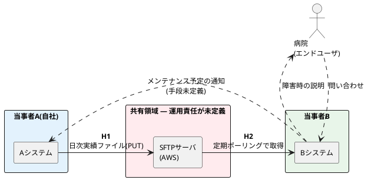

# 全体図の記法

**この図はシーケンス図ではない。** 障害の時系列も、認識の乖離も描かない。図の仕事は1つだけである。

> 誰と誰が、何を、どの経路でやり取りしていて、引き渡し点がどこにいくつあるか

障害事例の中身は表Aに、決めるべき事項は表Bにある。図に情報を足したくなったら、表に書くべき内容でないか先に疑うこと。図が読めなくなると、全体像を1枚で見せるという唯一の役割を失う。

## 基本形



上のプリアンブルは検証済みである。`skinparam rectangle { ... }` のようなブロック形式は構文エラーになるので使わないこと。

## 規約

**当事者ごとに `rectangle` で囲む。** 中の `component` がその当事者の保有物である。保有者と運用者が異なる場合は、囲みのラベルに両方書く(例: `当事者A(保有) / C社(運用)`)。

**中間基盤は独立した囲みにする。** 運用責任が未定義なら `#FFEBEE`(赤系)、決まっているならその当事者の囲みに入れる。**この塗り分けが図の主要な情報**であり、責任の空白地帯を一目で示す。

**矢印には必ず引き渡し点番号を太字で書く。** 番号は表A・表Bと共通のキーである。番号のない矢印を描かない。

| 記法 | 用途 |
|---|---|
| `-->` 実線 | データが定常的に流れる引き渡し点(番号付き) |
| `..>` 破線 | 人手の連絡経路。**引き渡し点ではないので番号を振らない**。関係性の把握のために描くだけで、走査対象外であることが分かるようにする |

人手の連絡経路(メンテ予定の連絡、問い合わせ、説明)は破線で描いてよいが、番号は振らない。番号付きの矢印だけが表A・表Bの走査対象である。

**色分け** — 当事者ごとに囲みの背景色を変える。

| 用途 | 色 |
|---|---|
| 自社側 | `#E3F2FD` |
| 相手方 | `#E8F5E9` |
| 責任が未定義の領域 | `#FFEBEE` |
| エンドユーザ | `actor` で表現(囲まない) |

## 凡例

記法を知らない読み手が見る前提で、必ず入れる。

```plantuml
legend right
  |= 記法 |= 意味 |
  | **H1** 等 | 引き渡し点番号(表A・表Bと共通) |
  | 実線 | 定常的に流れる情報 |
  | 破線(番号なし) | 人手の連絡経路(走査対象外) |
  | <back:#FFEBEE>赤の囲み</back> | 運用責任が未定義の領域 |
endlegend
```

## やってはいけないこと

- **障害の時系列を描く** — 表Aの仕事である
- **引き渡し点番号のない矢印を描く** — 表と対応が取れなくなる
- **推測した経路を実線で描く** — 未確認の経路は破線にし、ラベルに `(未確認)` と書く。この図は協議の場に出る可能性がある
- **要素が15を超えても1枚に収める** — その場合はデータフローの単位で図を分ける
